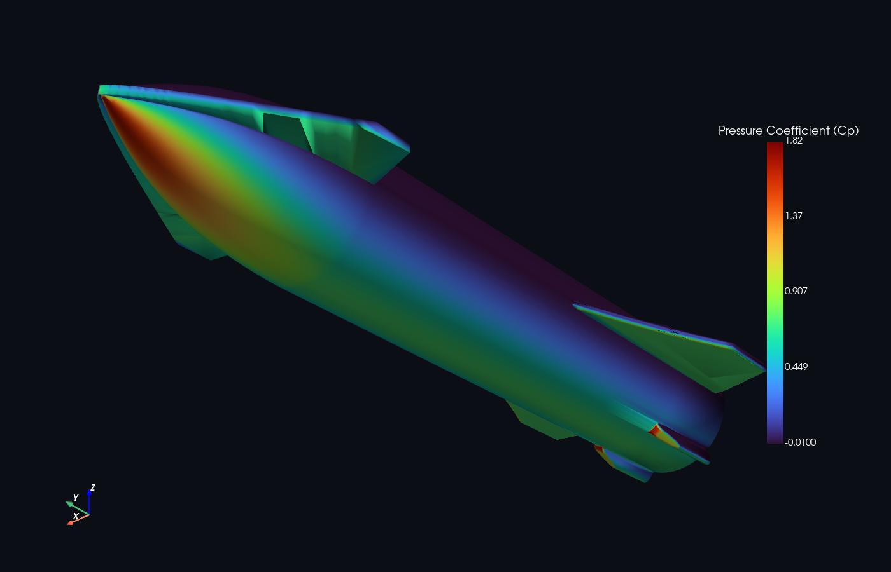

# Hypersonic Newtonian Aerodynamics Solver

A Python solver that computes hypersonic aerodynamic forces and surface pressure distributions on 3D geometries (`.stl`) using Newtonian impact theory.



---

## 1. Newtonian Theory

In hypersonic flight ($M_\infty \gg 1$), the shock layer lies extremely close to the vehicle surface. **Newton's impact theory** models this flow by assuming that incoming fluid particles travel in straight undisturbed lines until they strike a surface:
- **Windward Faces**: Particles lose their normal momentum upon impact, exerting a pressure proportional to the square of the local flow inclination angle:
  $$C_p = C_{p,\text{max}} \sin^2\theta$$
  where $\theta$ is the angle between the incoming freestream and the surface, and $C_{p,\text{max}}$ is determined from the freestream Mach number via the Rayleigh Pitot formula.
- **Shadowed & Leeward Faces**: Regions turned away from the flow or blocked by upstream geometry (computed via ray-tracing) experience no direct particle impacts ($C_p \approx C_{p,\text{wake}}$).
- **Force & Moment Integration**: Surface pressures are integrated over all triangular facets to yield total aerodynamic coefficients ($C_d, C_l, C_y, L/D$), aerodynamic moments ($C_m, C_l, C_n$), and static stability derivatives.

---

## 2. Inputs & Outputs

### Inputs
- **3D Surface Mesh (`.stl`)**: Triangular surface geometry of the vehicle (e.g., `starshipv21.stl`).
- **Configuration (`config.yaml`)**:
  - **Flight Condition**: Angle of attack ($\alpha$), sideslip angle ($\beta$), freestream Mach number ($M_\infty$).
  - **Vehicle Body Axes**: Roll (nose), pitch (starboard), and yaw (dorsal) unit vectors.
  - **Aerodynamic Reference**: Reference area ($S_{\text{ref}}$), reference length ($L_{\text{ref}}$), and Center of Gravity (CG).

### Outputs
Saved automatically in `results/`:
- **`newtonian_solution.vtu`**: 3D solution mesh viewable in ParaView or the built-in 3D viewer (contains $C_p$, $M_{\text{local}}$, surface normals, and windward/shadow status).
- **`aerodynamic_summary.json`**: Complete performance metrics ($C_l, C_d, L/D$, pitching/rolling/yawing moments, and stability derivatives).
- **`aerodynamic_results.npz`**: Compressed NumPy arrays for custom post-processing.

---

## 3. Usage

### Install Dependencies
```bash
pip install -r requirements.txt
```

### Step 1: Verify Setup & Orientation
Check mesh geometry and flow orientation in an interactive 3D window:
```bash
python 01_verify_setup.py
```

### Step 2: Compute Forces
Run the vectorized solver with ray-traced shadow detection:
```bash
python 02_compute_forces.py
```

### Step 3: Inspect Results
Print the summary table and open the interactive 3D pressure viewer:
```bash
# Print summary metrics in terminal
python 03_postprocess.py

# Open interactive 3D VTK viewer (press 'w' for wireframe, 'c' to cycle Cp / Mach)
python 03_postprocess.py --interactive
```